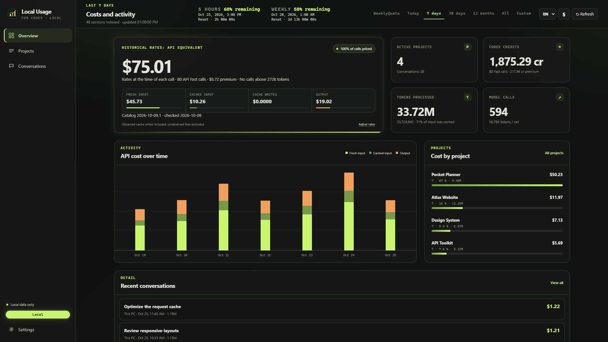
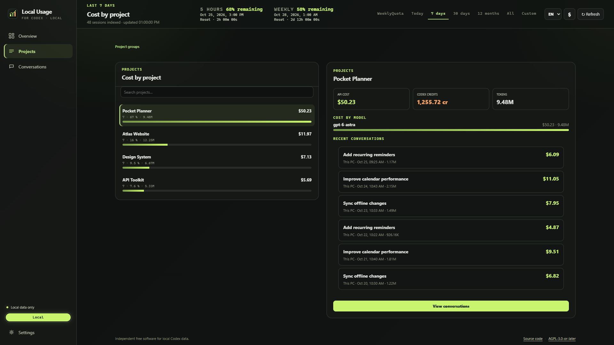
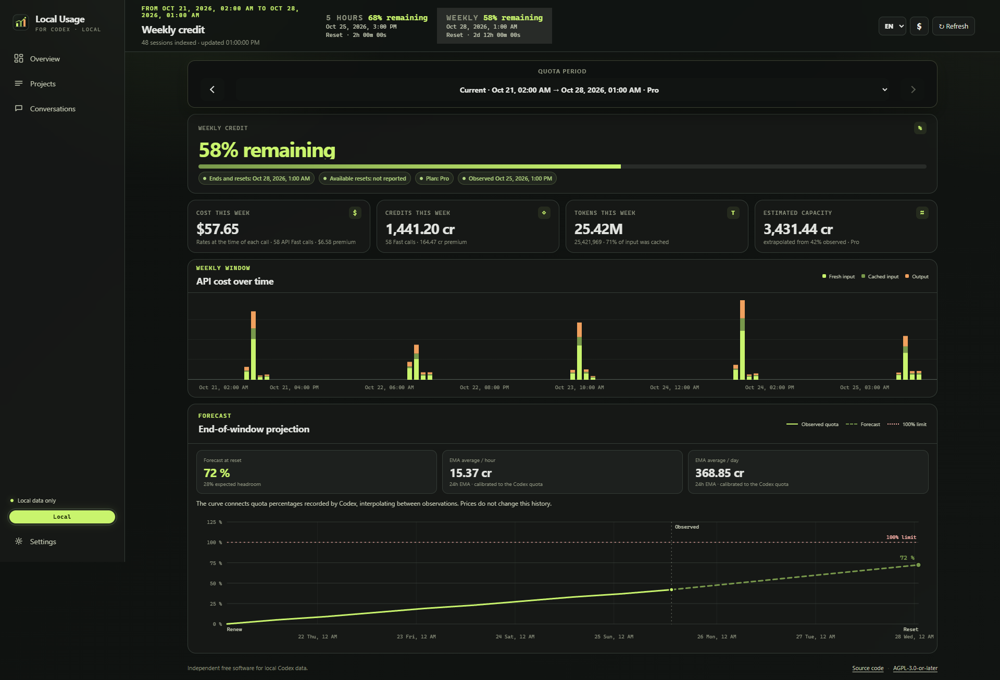
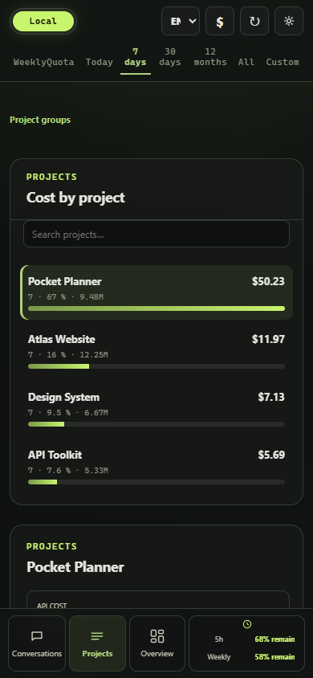

# Dashboard screenshots

These are browser captures of the real Local Usage dashboard, using entirely synthetic projects, conversation titles, calls and quota observations. No local Codex sessions, account details or credentials are used.

The committed images show the UI published on `main` at `63d8b844a2f401a7bdf8e86ae2431162baab5cf5` (version 1.6.2), in English with the original green theme. The demo clock is fixed at October 25, 2026, 12:00 UTC. Desktop captures use 1920 × 1080; the weekly quota capture includes the complete page. The mobile capture uses a 390 × 844 browser viewport.

| Overview | Project details |
| --- | --- |
| [](overview.png) | [](projects.png) |

[](weekly-quota.png)

<p align="center">
  
</p>

## Regenerate

From the repository root, with Node.js and Chrome installed:

```sh
npm ci --prefix desktop
node scripts/capture-screenshots.mjs
```

The script serves `public/` on an ephemeral loopback port, generates its data in memory, captures the four views and closes its browser and server. It uses the existing Playwright development dependency in `desktop/`; no runtime dependency is added. Set `SCREENSHOT_BROWSER=msedge` to use Edge instead of Chrome.

To capture assets from a separately prepared release, pass `--source <public-directory>`. No build, collector, Mesh connection or live usage server is needed. The script checks for page errors, failed HTTP responses, populated views and horizontal page overflow at the captured sizes. See [capture-manifest.json](capture-manifest.json) for the scenario and viewport settings. Mobile capture checks use browser emulation; they do not constitute a physical-phone test.

After regenerating, inspect all four images and update the UI revision above before committing them.
